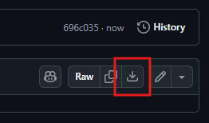

# CombatMissionFixes

Fixes for the Steam versions of Combat Mission games released by SNEG. (SNEG is awesome!)

Both **Combat Mission Barbarossa to Berlin** and **Combat Mission Afrika Korps** lose the ability to target with vehicles when you enable the <kbd>WASD</kbd> option. A game-specific DLL shim enables the <kbd>WASD</kbd> option and patches the game at run-time. The DLL defines what keyboard keys should be remapped. The <kbd>D</kbd> key (`Hull Down`) is remapped to <kbd>T</kbd> for tanks, so that <kbd>WASD</kbd> can control the camera. However, it doesn't remove the mapping of <kbd>T</kbd> for the `Target` command, causing a conflict. The game resolves that conflict by removing the `Target` command. The fix is to adjust that DLL directly, rebinding the `Hull Down` command to nothing. This avoids the conflict and restores <kbd>T</kbd> to `Target`. The only way to trigger the `Hull Down` command is to right-click on the vehicle and choose the command.

To download the patch file, navigate to the file and click the download icon. Each file is listed in the appropriate section. The download icon is located on the right-side of the screen and looks like the following image:

## Combat Mission 2: Barbarossa to Berlin

[Patch fix file: `cmbb.bps`](cmbb.bps)

To fix this game, patch the `cmbb.dll` file in your installation directory. As I'm not distributing any binaries, you'll have to apply this patch yourself. I'm using game console ROM hacking & patching apps to apply the patch, as that's quite a large ecosystem of tools to choose from.

The patch is in BPS format, which validates you have the correct source file for patching. You can use any rom patching tool that supports BPS files, but I used https://www.marcrobledo.com/RomPatcher.js/ in the creation of the BPS file and in testing.

1. Download the BPS file from the releases here on GitHub.
2. Open https://www.marcrobledo.com/RomPatcher.js/ and click on the **ROM file** box to open the file dialog.
3. Navigate to your game folder (most likely `C:\Program Files (x86)\Steam\steamapps\common\Combat Mission Afrika Korps`) and select the `cmbb.dll` file.

   Data for my version of the file, which must match:

   | Hash Type | Hash Value |
   | --- | --- |
   | CRC32 | f88ef78b |
   | MD5 | 51f8859c3d3af25a8aa24ed54330ff4a |
   | SHA-1 | c2d161ba0a9c012105ac11eff8fc16cba4d9449a |

4. Click on the **Patch file** box and open the file dialog.
5. Select the `cmbb.bps` file downloaded from this repository.
6. Click **Apply patch**.

   This downloads the file, as a DLL file is output, your browser may try to prevent you from downloading the file as unsafe. Remember, this is a patched version of your own file. You'll have to bypass these checks. Alternatively, you can use some other tool to patch locally and not through a browser.

7. In your game directory, rename your original `cmbb.dll` file to something else, as a backup.
8. Move the downloaded file to the game directory and rename it to `cmbb.dll`.

## Combat Mission 3: Afrika Korps

[Patch fix file: `cmak.bps`](cmak.bps)

To fix this game, patch the `cmak.dll` file in your installation directory. As I'm not distributing any binaries, you'll have to apply this patch yourself. I'm using game console ROM hacking & patching apps to apply the patch, as that's quite a large ecosystem of tools to choose from.

The patch is in BPS format, which validates you have the correct source file for patching. You can use any rom patching tool that supports BPS files, but I used https://www.marcrobledo.com/RomPatcher.js/ in the creation of the BPS file and in testing.

1. Download the BPS file from the releases here on GitHub.
2. Open https://www.marcrobledo.com/RomPatcher.js/ and click on the **ROM file** box to open the file dialog.
3. Navigate to your game folder (most likely `C:\Program Files (x86)\Steam\steamapps\common\Combat Mission Afrika Korps`) and select the `cmak.dll` file.

   Data for my version of the file, which must match:

   | Hash Type | Hash Value |
   | --- | --- |
   | CRC32 | 54526c62 |
   | MD5 | 650623fdfcfe123bd20875f9ab911eae |
   | SHA-1 | cf95122f5439f3e003d418cc678620627df03110 |

4. Click on the **Patch file** box and open the file dialog.
5. Select the `cmak.bps` file downloaded from this repository.
6. Click **Apply patch**.

   This downloads the file, as a DLL file is output, your browser may try to prevent you from downloading the file as unsafe. Remember, this is a patched version of your own file. You'll have to bypass these checks. Alternatively, you can use some other tool to patch locally and not through a browser.

7. In your game directory, rename your original `cmak.dll` file to something else, as a backup.
8. Move the downloaded file to the game directory and rename it to `cmak.dll`.
